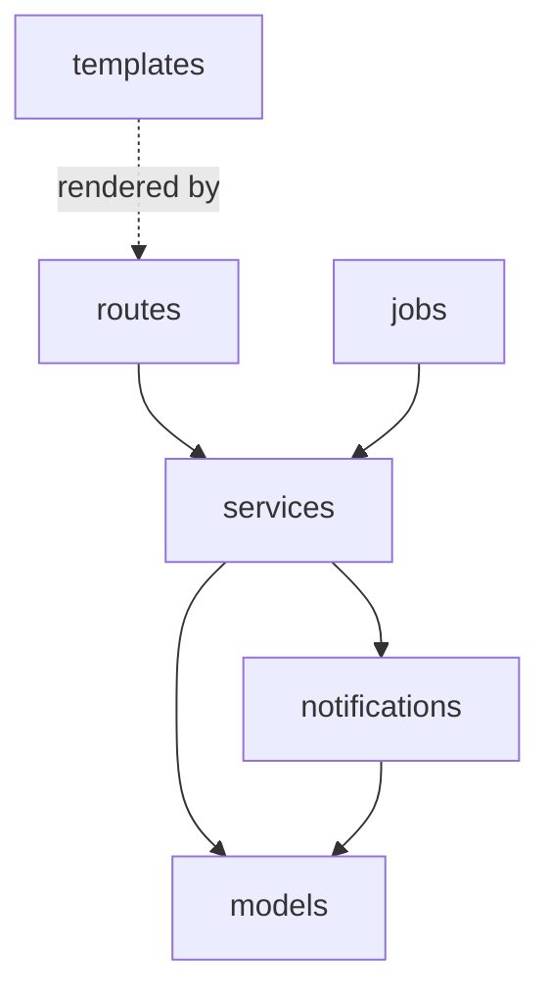
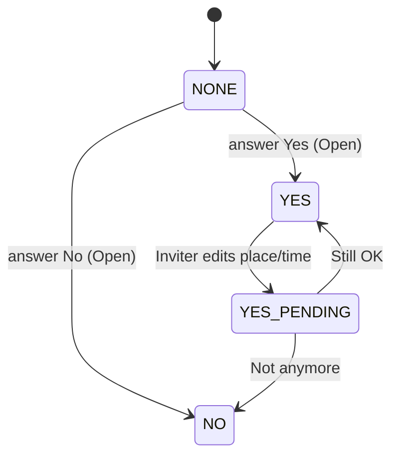
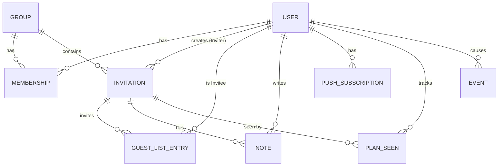
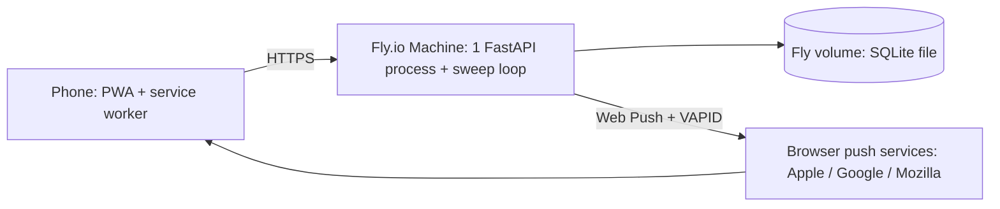

# Architecture Spine — Low-pressure friend invite app v1

## Design Paradigm

**Layered monolith.** One FastAPI process serves HTML pages (Jinja2 + HTMX), holds all logic, and owns one SQLite database. Layers map to packages:

| Layer | Package | Does | Never does |
| --- | --- | --- | --- |
| Routes | `app/routes/` | Parse the request, get the current User, call one service, render a template | Query the database, decide rules |
| Services | `app/services/` | All business rules, visibility, state changes, transactions | Render HTML, read the request |
| Models | `app/models/` | SQLModel tables, enums, the shared UTC datetime type | Contain rules |
| Notifications | `app/notifications/` | Build and send Web Push messages | Decide who may see what (asks services) |
| Jobs | `app/jobs/` | The deadline sweep loop | Contain rules (calls services) |



## Invariants & Rules

### AD-1 — Layered monolith, one direction [ADOPTED]

- **Binds:** all
- **Prevents:** routes or templates reading the database directly and skipping rules.
- **Rule:** Dependencies follow the diagram above only. Routes and jobs call services; only services (and `notifications` for subscriptions) touch the database session. Nothing imports from `routes`.

### AD-2 — One visibility policy

- **Binds:** FR-5, FR-6, FR-9, FR-11, FR-12, FR-16, NFR Privacy
- **Prevents:** a page or notification leaking No Answers, the Guest List, Notes, or an Invitation to someone who must not see it; leaking that a hidden Invitation exists.
- **Rule:** All "who may see what" rules live in `app/services/visibility.py`.
  - Every read **and write** of an Invitation starts with `visibility.get_visible_invitation(user, invitation_id, now)`. It raises `NotFound` when the User may not see it. `NotAllowed` (403) is used only for a User who can already see the Invitation.
  - A User can see an Invitation if they are its Inviter, or if they have a `GuestListEntry` and its Status is not Draft. Members not on the Guest List never see it, also not through My Plans or notifications.
  - The Yes List returns only `YES` and `YES_PENDING` entries (pending ones marked "not confirmed yet"). No function returns `NO` or `NONE` entries outside services.
  - Invitees see the Yes List before answering; nobody except the Inviter sees the Guest List.
  - Notes are visible to the Inviter and to Users whose answer is `YES` or `YES_PENDING`.
  - The public Group Link page shows only the Group name and the name of the Member who shared it.

### AD-3 — One owner for Invitation changes

- **Binds:** FR-4, FR-5, FR-7, FR-8, FR-10, FR-11, FR-13, FR-14, FR-15, FR-16
- **Prevents:** two code paths changing an Invitation, a Guest List entry, a Note, or `PlanSeen` with different checks or missing notifications.
- **Rule:** Only `app/services/invitations.py` writes `Invitation`, `GuestListEntry`, `Note`, and `PlanSeen` rows. Each change is one service function that (1) finds the Invitation via AD-2, (2) checks the action is allowed in the current Status (table below), (3) writes in one transaction and commits, (4) only then asks `notifications` to send. Allowed actions:

| Action | Draft | Open | Closed | Cancelled |
| --- | --- | --- | --- | --- |
| Edit Draft (any field, no push) | Inviter | – | – | – |
| Publish | Inviter | – | – | – |
| Answer Yes/No | – | Invitee | – | – |
| Edit place/time (FR-14) | – | Inviter, before `when_start` | Inviter, before `when_start` | – |
| Reconfirm (Still OK / Not anymore) | – | Invitee, before `when_start` | Invitee, before `when_start` | – |
| Cancel | – | Inviter | Inviter | – |
| Add Note | – | Inviter, Yes List | Inviter, Yes List | Inviter, Yes List |
| Delete Draft | Inviter | – | – | – |

### AD-4 — Invitation fields and computed Status

- **Binds:** FR-4, FR-6, FR-8, FR-10, FR-13, FR-14, FR-15, FR-16
- **Prevents:** a restarted server leaving an Invitation "Open" after its Deadline; stories inventing their own fields for "when", the Deadline, or "Updated".
- **Rule:** `Invitation` stores: `what`, `where` (null = open), `when_start`, `when_end` (null = exact time; set = time window), `cost_tag`, `deadline_minutes` (chosen from a fixed list in `config`), `published_at`, `deadline_at`, `cancelled_at`, `place_time_changed_at`, `result_notified_at`.
  - `publish()` is the only place that sets `published_at` and `deadline_at = published_at + deadline_minutes`.
  - `deadline_at < when_start` is checked by one function, on publish and on every edit of place/time.
  - Status is computed by one function `status(invitation, now)`: `cancelled_at` set → Cancelled; `published_at` null → Draft; `now >= deadline_at` → Closed; else Open. There is no `status` column.

### AD-5 — Guest List and Answer state machine

- **Binds:** FR-5, FR-8, FR-9, FR-14
- **Prevents:** extra columns per edit; two quick taps flipping an Answer; Guest Lists that change after publishing.
- **Rule:** `GuestListEntry` has one row per invited Member per Invitation (the Inviter has no row), with `answer` and `answered_at`. A Draft may hold rows; `publish()` writes the final rows (default: all current Members) and they never change afterwards. Members who join later do not see the Invitation. Allowed transitions only:



  - Every change is a conditional update (`UPDATE … WHERE id = ? AND answer = <expected>`); 0 rows changed raises `InvalidState`.
  - A reconfirm request carries the `place_time_changed_at` the User saw; if it is older than the current value, it is refused and the page reloads.
  - After `when_start`, no transitions happen. `NONE` after the Deadline means No. `YES_PENDING` stays on the Yes List (marked "not confirmed yet"), keeps Notes access, and receives cancel and edit notifications.

### AD-6 — Time handling

- **Binds:** FR-4, FR-10, FR-14, FR-15, FR-16
- **Prevents:** Deadlines closing an hour early or late; tests that depend on the real clock.
- **Rule:** All datetimes are stored as UTC through one shared `UTCDateTime` column type in `app/models/`. Conversion to and from `Europe/Rome` happens only in forms and templates. Service functions that depend on time take `now: datetime` as a parameter; only routes and jobs read the clock.

### AD-7 — Notifications and the deadline sweep

- **Binds:** FR-10, FR-12, FR-13, FR-14, SM-C1
- **Prevents:** duplicate, missing, or wrongly addressed notifications; results sent for cancelled plans.
- **Rule:** Only `app/notifications/` sends Web Push (pywebpush, VAPID keys from env, VAPID `sub` is a real `mailto:` address). Push is always sent after the database commit; a failed push is logged and never undoes the change; a subscription answering HTTP 404/410 is deleted. v1 notification types and recipients:

| Type | Recipients |
| --- | --- |
| New Invitation (on publish) | Every Invitee on the Guest List |
| Deadline result | The Inviter only |
| Cancelled | Users with `YES` or `YES_PENDING` |
| Place/time changed | Users with `YES` or `YES_PENDING` (all become `YES_PENDING`), and, while Status is Open, Invitees with `NONE` (so they see the new details before deciding) |

  - All user-facing notification and result texts (including "Nobody is free tonight 🌙") come from one module `app/notifications/messages.py`.
  - A loop in `app/jobs/` runs every 60 seconds and calls `invitations.close_and_notify(now)`. That function claims each Invitation with one conditional update (`SET result_notified_at = now WHERE result_notified_at IS NULL AND published_at IS NOT NULL AND cancelled_at IS NULL AND deadline_at <= now`), commits, then sends. An Invitation is claimed at most once.

### AD-8 — One always-on instance with one SQLite database

- **Binds:** AD-7, deployment, all data
- **Prevents:** two sweeps sending double notifications; a sleeping machine sending none; two processes writing one SQLite file.
- **Rule:** Production runs exactly one Fly.io Machine with one Uvicorn worker: `auto_stop_machines = "off"`, `min_machines_running = 1`, scaled to count 1. The SQLite database lives on a Fly volume mounted on that Machine, in WAL mode. Scaling out requires first moving the database and the sweep (see Deferred).

### AD-9 — Authentication, sessions, and CSRF

- **Binds:** FR-1, FR-3, FR-8, FR-12, all routes
- **Prevents:** pages that forget to check login; weak password storage; cross-site form posts; notification buttons that cannot pass the CSRF check.
- **Rule:**
  - Login is email + password. Passwords are hashed with `pwdlib` (Argon2).
  - The session is Starlette's signed `SessionMiddleware` cookie holding only the User id, the User's `session_version` and a CSRF token (`current_user` rejects a cookie whose `session_version` is older than the User's; a password reset increments it): `HttpOnly`, `SameSite=Lax`, `https_only=True` in production, lifetime 90 days.
  - Every route except sign-up, log-in, static files, the Group Link landing page, and the push-answer endpoint requires a logged-in User through one dependency `current_user`.
  - Every POST carries the session's CSRF token (hidden field `csrf_token`, or the `X-CSRF-Token` header that HTMX adds from the page `<body hx-headers>`). One dependency checks it.
  - Notification buttons (Android/desktop) post to one endpoint with a signed action token (itsdangerous) placed in the push payload. The token holds the `GuestListEntry` id and the answer, and expires at `deadline_at`. This endpoint is exempt from the cookie and CSRF check; it still goes through AD-3 and AD-5.
  - Authorization (may this User do this?) is checked in services (AD-2, AD-3), not in routes.

### AD-10 — Schema changes only through migrations

- **Binds:** all models
- **Prevents:** the laptop and production databases having different tables.
- **Rule:** Tables are created and changed only by Alembic migrations, configured with `render_as_batch=True` (needed for SQLite). `SQLModel.metadata.create_all` is used only in tests. Enums are stored as strings. Migrations run on every deploy before the app starts.

### AD-11 — HTMX response convention

- **Binds:** all routes that render HTML
- **Prevents:** full pages inserted inside other pages; each page inventing its own partial rules.
- **Rule:** A route returns the full page template for a normal request, and only the fragment template (`templates/fragments/…`) when the `HX-Request` header is present. Fragments never include `<html>` or the layout. HTMX 2.x only.

### AD-12 — Metrics data from day one

- **Binds:** PRD §7 (SM-0 … SM-C2)
- **Prevents:** metrics that cannot be computed after the test because no story recorded the data.
- **Rule:** Services append rows to one `Event` table (`user_id`, `type`, `invitation_id`, `group_id`, `at`) for: `group_joined`, `invitation_published`, `answered`, `note_added`, `push_enabled`, `push_disabled`. Only services write it. No personal content (Note text, places) goes into it.

## Consistency Conventions

| Concern | Convention |
| --- | --- |
| Naming | PRD Glossary terms used verbatim in code: `Invitation`, `GuestListEntry`, `Note`, `Group`, `Membership`, `User`, `PushSubscription`, `PlanSeen`, `Event`. Python `snake_case` files and functions; `PascalCase` classes; enum values in `UPPER_CASE`. |
| IDs | Integer primary keys inside the app. The Group Link uses a separate random token (`secrets.token_urlsafe`), never the database id. |
| Dates | UTC in the database (AD-6); `Europe/Rome` on screen, format `Fri 21 Nov, 20:00`. |
| Errors | Services raise `NotFound`, `NotAllowed`, `InvalidState`; one exception handler turns them into 404 / 403 / 409 pages or fragments. |
| Notifications off | "Notifications off" means the User has no `PushSubscription`. The banner (FR-12) is shown once; `User.push_banner_dismissed_at` records the dismissal. |
| "Updated" mark | An Invitation is "Updated" for a User when the latest of `place_time_changed_at`, `cancelled_at`, or newest Note time is after that User's `PlanSeen.seen_at`. My Plans hides an Invitation 24 hours after `when_end` (or `when_start`). |
| Onboarding | The Group Link is opened in the browser; the User signs up and joins there, then adds the app to the home screen and logs in once inside it (iPhone keeps separate cookies for the home-screen app). |
| Config | All secrets and settings from environment variables, read in one `app/config.py` (pydantic-settings). Nothing secret in git. |
| Logging | Python `logging` to stdout, one line per event; never log passwords, cookies, tokens, or push keys. |
| Tests | `pytest`. Services are tested directly with a fixed `now`. Each AD-2 rule has a test proving a No Answer and a hidden Invitation never appear. |

## Stack

| Name | Version |
| --- | --- |
| Python | 3.14 |
| uv | 0.13.7 |
| FastAPI | 0.162.x (pin exact) |
| python-multipart | latest, pinned |
| SQLModel | 0.0.49 |
| Alembic | 1.20.1 |
| SQLite | bundled with Python, WAL mode |
| Jinja2 | 3.1.6 |
| HTMX | 2.0.11 |
| pwdlib[argon2] | 0.3.1 |
| itsdangerous | latest, pinned |
| pydantic-settings | latest, pinned |
| pywebpush | 2.5.0 |
| Hosting | Fly.io, 1 × shared-cpu-1x 512 MB, always on, 1 GB volume |

## Structural Seed

**Core entities**



**Deployment and environments**



| Environment | Database | Notes |
| --- | --- | --- |
| Local | SQLite file in the project | `uv run`; push testing needs HTTPS (e.g. a tunnel) and a real iPhone test before the friend test |
| Production | SQLite on a Fly volume | One Machine; secrets via `fly secrets`; migrations run on deploy; daily volume snapshots as backup |

**Source tree**

```text
app/
  main.py            # FastAPI app, middleware, starts the sweep loop
  config.py          # settings from environment
  models/            # SQLModel tables, enums, UTCDateTime
  services/          # visibility.py, invitations.py, groups.py, accounts.py, metrics.py
  notifications/     # push sending, messages.py
  jobs/              # deadline sweep loop
  routes/            # accounts, groups, invitations, plans, push_answer
  templates/         # pages + fragments/
  static/            # htmx, css, manifest.json, service-worker.js, icons
migrations/          # Alembic
tests/
fly.toml
```

## Capability → Architecture Map

| Capability / Area | Lives in | Governed by |
| --- | --- | --- |
| FR-1 Sign up / log in | `services/accounts.py`, `routes/accounts.py` | AD-9 |
| FR-2, FR-3 Groups, Group Link | `services/groups.py` | AD-2, AD-9, IDs and Onboarding conventions |
| FR-4, FR-5, FR-15 Create, Guest List, Draft | `services/invitations.py` | AD-3, AD-4, AD-5, AD-6 |
| FR-6 Open Invitations | `services/visibility.py` | AD-2, AD-4 |
| FR-7, FR-13, FR-14 Change rules, cancel, edit | `services/invitations.py` | AD-3, AD-4, AD-5, AD-7 |
| FR-8 Answer (page and notification button) | `services/invitations.py`, `routes/push_answer.py` | AD-3, AD-5, AD-9 |
| FR-9 Silent No | `services/visibility.py` | AD-2, AD-5 |
| FR-10 Deadline result | `jobs/`, `services/invitations.py`, `notifications/` | AD-4, AD-7, AD-8 |
| FR-11 Notes | `services/invitations.py`, `services/visibility.py` | AD-2, AD-3 |
| FR-12 Notifications, banner | `notifications/`, `static/service-worker.js` | AD-7, AD-9, Notifications-off convention |
| FR-16 My Plans | `services/visibility.py`, `services/invitations.py` | AD-2, AD-3, "Updated" convention |
| PRD §7 metrics | `services/metrics.py` | AD-12 |
| NFR Phone first / Simple | `templates/`, `static/` | AD-11 |

## Deferred

- **PostgreSQL:** later, when there are more users or more than one server; AD-10 migrations keep the move possible.
- **Self-service password reset:** needs an email provider; v1 uses an admin command run by Erfan. Revisit with magic link or Google sign-in.
- **Google sign-in:** later version; must reuse the same session (AD-9).
- **Live chat (WebSockets):** out of scope; Notes refresh on open or by HTMX polling.
- **More than one instance:** needs a shared database and an outside scheduler first (AD-8).
- **Notification limits** (quiet hours, daily caps): v1.1; must live in `notifications/` (AD-7).
- **Photo storage, AI suggestions, money features:** later; not modelled now.
- **CSS framework / visual design:** left to UX work and the first stories; must meet the PRD phone NFRs.
- **Monitoring:** Fly.io logs only for the 4-week test.
- **Account deletion, leaving Groups:** out of v1 scope (PRD §6.2).
